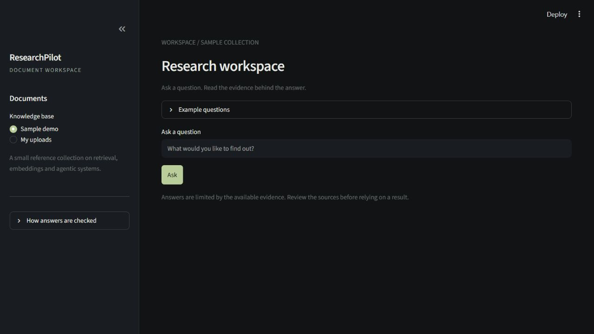
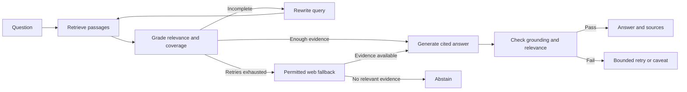

# ResearchPilot

### Agentic AI Research & Knowledge Assistant

Ask questions across PDFs, Markdown files and text documents, then check the
passages behind each answer. ResearchPilot grades retrieved evidence, rewrites
queries when needed, and reviews answers for grounding and relevance. If it
cannot find relevant evidence, it says so.

Maintained by [Saumya Joshi](https://github.com/Saumyathecoder).



## What it does

- **Bring your own documents.** Upload multiple PDFs, Markdown files or UTF-8 text
  files. Uploaded collections stay separate from the sample knowledge base and
  from other browser sessions.
- **Trace answers to evidence.** Answers cite numbered passages; PDF sources keep
  their original filename and page number.
- **Recover from weak retrieval.** A coverage check distinguishes a small amount
  of complete evidence from passages that only partly answer the question.
  Incomplete retrieval can trigger query rewriting and, in sample mode, web search.
- **Review generated answers.** Grounding and answer relevance are checked
  separately. Failed checks trigger bounded retries; exhausted retries are shown
  with a caveat.
- **Handle failures clearly.** Timeouts, rate limits, empty responses and invalid
  structured output produce actionable errors instead of a fabricated verdict.

The interface is a single-turn document workspace. Sources are visible beside
the answer, with an optional agent trace for inspecting the decisions taken.

## How it works



Sample mode also routes general and unrelated questions before retrieval.
Upload mode always searches the selected documents and disables web fallback.
The sample collection uses persistent Chroma; uploads use a session-owned
in-memory index. Both support TF-IDF or sentence-transformer embeddings.

**Stack:** Python 3.11 · Streamlit · LangGraph · Chroma · scikit-learn · pypdf ·
Groq / Anthropic · sentence-transformers

## Run locally

These commands are for a new Windows checkout:

```powershell
git clone https://github.com/Saumyathecoder/ResearchPilot.git
cd ResearchPilot
python -m venv .venv
.\.venv\Scripts\python.exe -m pip install -r requirements.txt
Copy-Item .env.example .env
```

Add your `GROQ_API_KEY` to `.env`. To use Anthropic instead, set
`RAG_LLM_PROVIDER=anthropic` and provide `ANTHROPIC_API_KEY`. Model settings and
optional controls are listed in `.env.example`.

```powershell
.\.venv\Scripts\python.exe -m streamlit run app.py --server.address localhost
```

Open [localhost:8501](http://localhost:8501). The sample index is created if empty.
For an existing checkout, reuse its environment and keep the existing `.env`.
On macOS/Linux, use `.venv/bin/python` in place of `.\.venv\Scripts\python.exe`.

### Upload documents

Select **My uploads**, choose files and click **Index selected documents**. Ask a
question once the active filenames appear. Check answer references against the
**Sources** section, including the PDF page number.

Limits: 10 files, 10 MB per file, 30 MB total and 200 pages per PDF. PDFs must
contain extractable text; OCR is not included. Empty, corrupt, encrypted and
wholly textless files are rejected with an explanation.

Files and uploaded indexes are kept in session memory. Refreshing, session expiry
or a server restart may discard them. Relevant passages and questions are sent to
the configured model provider, so this is not local-only AI processing.

### CLI

```powershell
.\.venv\Scripts\python.exe -m scripts.ingest --rebuild
.\.venv\Scripts\python.exe -m src.cli "What three actions can Corrective RAG take based on retrieval confidence?"
```

Rebuilding replaces the local sample collection. If the embedding backend changes,
rebuild the index so queries and documents use the same fitted embedder.

## Evaluation

Local retrieval was compared at k=4 over the same 4 documents and 16 chunks,
without generation, web search or model judging.

| Question set | Backend | Document precision@4 | Document recall@4 | MRR@4 |
|---|---|---:|---:|---:|
| Original, 8 in-scope questions | TF-IDF | 0.46875 | 1.00000 | 1.00000 |
| Original, 8 in-scope questions | MiniLM | 0.56250 | 1.00000 | 1.00000 |
| Paraphrases, 8 in-scope questions | TF-IDF | 0.34375 | 0.87500 | 0.81250 |
| Paraphrases, 8 in-scope questions | MiniLM | 0.40625 | 1.00000 | 0.90625 |

MiniLM improved the aggregate paraphrase results but reduced document precision
on two individual queries. TF-IDF remains the default. These are small development
sets with document-level labels, not measurements of answer accuracy.

In one controlled live question, the coverage policy reduced provider requests
from **18 to 9** and query rewrites from **2 to 0**. Both runs returned the same
answer and passed the model's grounding/relevance checks. This is a single-case
result, not a general efficiency claim.

See [the evaluation report](docs/EVALUATION.md) for settings, dataset hashes,
regressions and reproduction commands.

## Tests

```powershell
.\.venv\Scripts\python.exe -m pytest -q
```

The last verified run passed **104 tests**. Coverage includes ingestion, page
metadata, session isolation, graph recovery, abstention, strict grader schemas,
provider failures, CLI errors and Streamlit controls. Model calls in the regression
suite are mocked; live integration checks are recorded separately.

## Limitations

- PDF reading order, tables and scanned pages can lose information during text
  extraction. Page numbers refer to physical PDF pages, not printed page labels.
- Coverage and quality checks are model judgments and can be wrong. Citations
  are not a formal proof that every claim is supported.
- Request timeouts and retry limits do not impose a single wall-clock deadline
  on the complete agent run.
- Web search is best effort. Snippets are checked for usable content and source
  URLs, not independently fact-checked.
- There is no persistent conversation history, OCR, authentication layer or
  FastAPI backend. The current application is intended for local research and demos.

## Development

[Development guide](docs/DEVELOPMENT.md) · [Evaluation report](docs/EVALUATION.md)

## Acknowledgments and license

Core RAG pipeline: [hejerr/agentic-rag](https://github.com/hejerr/agentic-rag), under
the MIT license. Component provenance and implementation changes are documented
in [CONTRIBUTIONS.md](docs/CONTRIBUTIONS.md). The original copyright and permission
notice are retained in [LICENSE](LICENSE).
