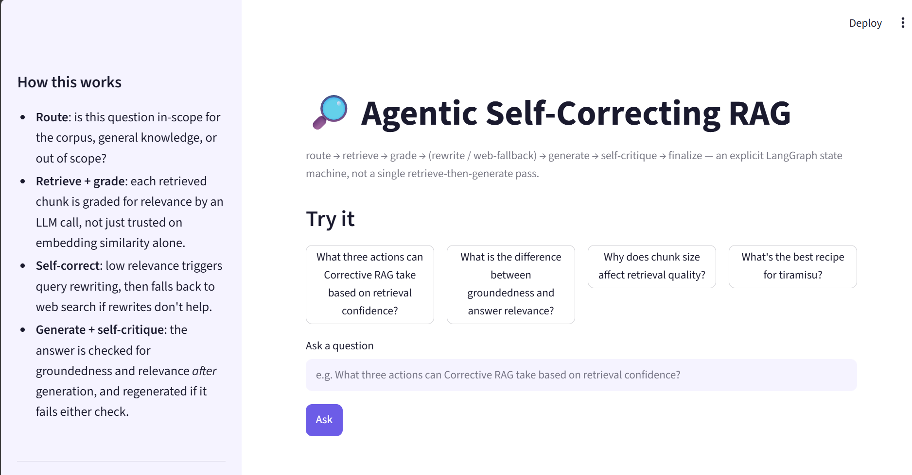

# Agentic Self-Correcting RAG

[](https://github.com/hejerr/agentic-rag/actions/workflows/ci.yml)
[](LICENSE)

A Retrieval-Augmented Generation system where retrieval and generation are
wrapped in an explicit **agent graph** that grades its own retrieval quality,
rewrites failing queries, falls back to web search, and checks its own
answers for hallucination and relevance before returning them — instead of
the fixed retrieve-then-generate pass most RAG tutorials stop at.

Built on the ideas behind **Corrective RAG (CRAG)** and **Self-RAG**, orchestrated
as a [LangGraph](https://github.com/langchain-ai/langgraph) state machine, with
a real evaluation harness comparing it against a naive baseline instead of
just asserting it's better.


*Streamlit UI showing the agent's full trace — routing, retrieval grading, query
rewrites, and self-critique — alongside the answer, run locally.*

## Why this exists

Naive RAG assumes retrieval always returns useful context. It doesn't — a
query can retrieve topically related but unhelpful chunks, the corpus can
simply lack the answer, or vocabulary mismatch between the question and the
source text can sink similarity search entirely. A naive pipeline still
generates an answer regardless, often a confident, wrong one, because
nothing in the pipeline ever checks whether the retrieval was actually good.

This project adds that missing control loop as a first-class part of the
architecture, not an afterthought.

## Architecture

```
                                 ┌────────────┐
                     ┌──────────►│   direct   ├──────────────┐
                     │           └────────────┘              │
        ┌────────┐   │           ┌────────────┐              │
   ──►  │ route  ├───┼──────────►│out_of_scope├──────────────┤
        └────────┘   │           └────────────┘              │
                     │           ┌────────────┐               ▼
                     └──────────►│  retrieve  │           ┌────────┐
                                 └─────┬──────┘           │  END   │
                                       │                  └────────┘
                                       ▼                       ▲
                              ┌────────────────┐               │
                              │ grade_documents│               │
                              └───────┬────────┘               │
                     enough relevant? │  not enough & retries left
                        │             ▼                        │
                        │     ┌────────────────┐                │
                        │     │ transform_query├──► retrieve    │
                        │     └────────────────┘  (bounded loop)│
                        │     not enough & no retries left      │
                        │             ▼                         │
                        │     ┌────────────────┐                │
                        │     │   web_search   │                │
                        │     └───────┬────────┘                │
                        ▼             ▼                          │
                              ┌────────────────┐                 │
                              │    generate    │◄────────────────┤
                              └───────┬────────┘   regenerate    │
                                      ▼             (bounded)    │
                              ┌────────────────┐                 │
                              │grade_generation│                 │
                              └───────┬────────┘                 │
                     passed ──────────┼────────── failed & retries left
                        │             │                     │
                        ▼             │                     ▼
                    finalize ◄────────┘          finalize_with_caveat
                        │                                   │
                        └───────────────► END ◄─────────────┘
```

**Design decisions worth calling out:**

- **Routing before retrieval.** Not every question needs the corpus — a
  cheap classification step decides between `retrieve`, `direct` (general
  knowledge), and `out_of_scope` (decline rather than hallucinate from an
  irrelevant corpus).
- **Retrieval grading (CRAG).** Each retrieved chunk is graded for relevance
  by a separate LLM call rather than trusting embedding similarity alone.
  Low aggregate relevance triggers query rewriting first (cheap), and falls
  back to web search only after rewrites are exhausted (CRAG's actual
  fallback strategy).
- **Generation self-critique (Self-RAG).** After generation, groundedness
  (is every claim supported by the retrieved context?) and answer relevance
  (does the answer address what was asked?) are checked **independently**,
  because a response can be grounded-but-off-topic or relevant-but-hallucinated.
- **Bounded retry loops.** Both the retrieval-correction loop and the
  generation-correction loop have a hard retry ceiling (`RAG_MAX_REWRITES`,
  `RAG_MAX_GEN_RETRIES`) so a stubborn failure degrades to a clearly-labeled
  best-effort answer instead of looping forever.
- **Pluggable, swappable embeddings.** Defaults to a local TF-IDF + SVD
  embedder (zero downloads, works fully offline, good enough to demo and
  test with) with a one-line swap to `sentence-transformers` for real
  semantic retrieval quality — see [Embeddings](#embedding-backends).

## Project structure

```
src/
  ingestion/     document loading + structure-aware chunking
  retrieval/     pluggable embeddings + Chroma vector store
  graders/       router, retrieval grader, query rewriter, generation grader
  generation/    grounded answer generation with source attribution
  tools/         web search fallback (DuckDuckGo, no API key needed)
  agent/         LangGraph state, nodes, and graph wiring
  evaluation/    metrics + naive baseline for comparison
  cli.py         command-line interface
  llm_client.py  thin Anthropic API wrapper
data/
  sample_docs/       small hand-written knowledge base (RAG/embeddings/agents)
  eval_dataset.json  QA pairs with expected source docs, for evaluation
scripts/
  ingest.py      build the vector store
  run_eval.py    run the naive-vs-agentic evaluation harness
tests/           offline-safe unit + integration tests (LLM calls mocked)
app.py           Streamlit demo UI
```

## Setup

```bash
git clone <this-repo>
cd agentic-rag
python -m venv .venv && source .venv/bin/activate   # or your tool of choice
pip install -r requirements.txt

cp .env.example .env
# edit .env and set GROQ_API_KEY=... (free key: https://console.groq.com/keys)
# (or set RAG_LLM_PROVIDER=anthropic and ANTHROPIC_API_KEY=sk-ant-... to use Claude instead)

python -m scripts.ingest --rebuild   # builds the vector store, no API key needed
```

## Usage

**CLI:**
```bash
python -m src.cli "What three actions can Corrective RAG take based on retrieval confidence?"
python -m src.cli --interactive
```

**Streamlit demo** (shows the full agent trace, retrieved context, and
groundedness/relevance verdicts alongside the answer):
```bash
streamlit run app.py
```

**As a library:**
```python
from src.agent.graph import run_agent

state = run_agent("How does chunk overlap affect retrieval quality?")
print(state["answer"])
print(state["trace"])          # every decision the agent made, in order
print(state["relevant_chunks"]) # the context actually used, with sources
```

## Evaluation

`scripts/run_eval.py` runs every question in `data/eval_dataset.json` through
**both** a naive single-pass RAG baseline and the full agentic pipeline, and
scores both on:

- **Retrieval precision/recall@k** against known expected source documents
- **Groundedness** (LLM-as-judge: is the answer supported by retrieved context?)
- **Answer relevance** (LLM-as-judge: does the answer address the question?)

```bash
python -m scripts.run_eval
```

This writes `eval_results/results.md` (summary table) and
`eval_results/results.json` (full per-question detail, including agent
traces). Requires an LLM provider key to be set (`GROQ_API_KEY` or
`ANTHROPIC_API_KEY`, matching `RAG_LLM_PROVIDER`), since every metric here
depends on an LLM call. Run it yourself and commit the resulting
`eval_results/` to your fork — that comparison table is the single most
convincing part of this repo for a reader deciding whether the "agentic"
part actually does anything.

## LLM providers

| Provider | Setup | Cost |
|---|---|---|
| `groq` (default) | free key at [console.groq.com/keys](https://console.groq.com/keys) | free tier (rate-limited) |
| `anthropic` | key at [console.anthropic.com](https://console.anthropic.com) | pay-per-use |

Switch via `RAG_LLM_PROVIDER` in `.env`. Every node in the agent graph calls
the same `complete()` / `complete_json()` functions in `src/llm_client.py`
regardless of provider, so swapping is a config change, not a code change.

## Embedding backends

| Backend | Setup | Quality | Use case |
|---|---|---|---|
| `tfidf` (default) | none, pure local | lexical, decent | demos, CI, offline dev |
| `st` (sentence-transformers) | `pip install sentence-transformers`, internet on first run | dense, semantic | real use |

Switch via `RAG_EMBEDDING_BACKEND=st` in `.env`.

## Testing

```bash
pytest -v
```

All 18 tests run fully offline: retrieval and chunking are tested against
the real TF-IDF vector store, and every LLM-dependent node (routing,
grading, generation, rewriting) is tested by monkeypatching the LLM calls
and asserting the **graph's control flow** — that a low relevance score
actually triggers a query rewrite, that a failed groundedness check actually
triggers a regeneration, that retry ceilings are actually respected — since
that control flow, not model output quality, is what this project is about.

## What this project deliberately does not do

- No re-ranking model (a cross-encoder reranker after retrieval is a natural
  next addition, and is called out as future work rather than pretending
  simple top-k cosine search is sufficient for production).
- No persistence of conversation history / multi-turn memory — this is a
  single-turn RAG agent, not a chat agent.
- The web search fallback (`ddgs`) is a best-effort, no-API-key-required
  choice; swap in Tavily/Serper/Bing in `src/tools/web_search.py` for
  production-grade fallback quality.

## License

MIT — see [LICENSE](LICENSE).
